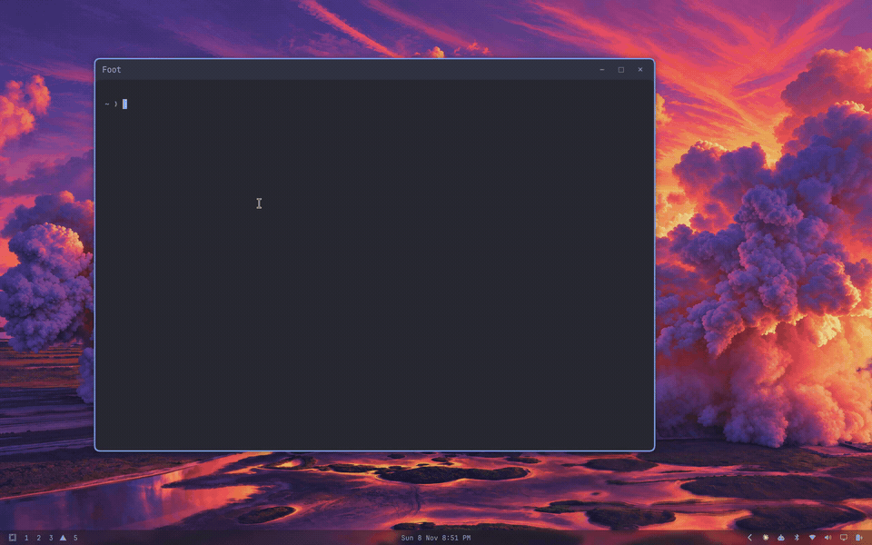
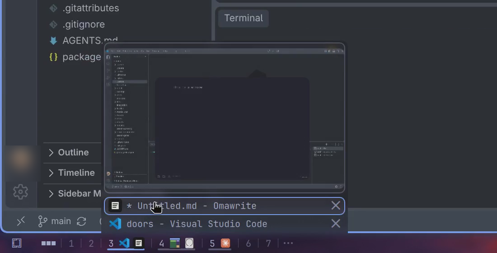
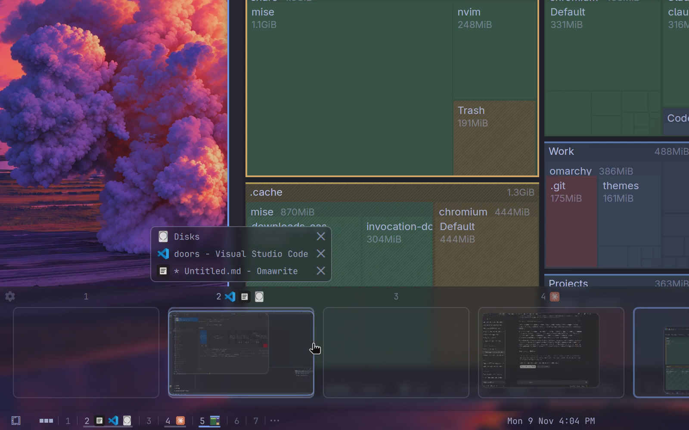

# Workspace Control for Omarchy

A better workspace row for the Omarchy bar, and a panel of live workspaces on a four finger swipe up. See every window on every workspace, then move, focus, close and reorder them by clicking and dragging.



[Watch the full recording](screenshots/workspace-control.mp4).

## Requirements

- Omarchy Quattro with Hyprland 0.56 or newer.
- A touchpad for the four finger swipe. Without one, open the panel with Super+E or the bar button.

Nothing else needs installing.

## Install

Plugins run unsandboxed inside the Omarchy shell, so read the code first.

```bash
omarchy plugin add https://github.com/dtpietrzak/omarchy-dtp-workspace-control.git --enable
```

It lands on the left of the bar. If you were using Omarchy's own workspace numbers, turn them off so you don't have two rows:

```bash
omarchy plugin disable omarchy.workspaces
```

## Remove

```bash
omarchy plugin remove io.github.dtpietrzak.workspace-control
rm -f ~/.config/omarchy/io.github.dtpietrzak.workspace-control.json
```

The swipe stays registered, doing nothing, until Hyprland next reloads. If you turned Omarchy's workspace numbers off, `omarchy plugin enable omarchy.workspaces` brings them back.

## On the bar



- The three rows before them open every app in a card under the bar, in the bar's background. Type to search, Up and Down to move, Enter or a click to open. Right-click an app to open it, keep it in the dock, or uninstall it. Escape clears the search, then closes the card, and so does a click anywhere else.
- The three squares open and close the panel.
- Right-click any of the widget's buttons for a menu of Settings, Workspace Panel and App List, each with its shortcut beside it.
- A number for each workspace, 1 to 7 plus any others that are open, with the icons of the apps on it, one per app. A grey line runs under a workspace with apps, and the current one is underlined in the theme's accent color.
- Click a number or its icons to go to that workspace. Drag a number along the bar to move that workspace: its windows take the new position's number and those it passed shift over by one.
- Hover a workspace with windows for a card with a live preview and a list of its windows. Click a window in either to go to it, use its × to close it, or drag it onto a number to move it there without leaving where you are. Drag it out onto the desktop to bring it to the workspace you're on; a floating window lands where you let go, shown by an outline as you carry it.
- The ... after the last number lists minimized windows. Click one or its ^ to bring it to the workspace you're on, use its × to close it, drag it onto a number to send it there, or drag it out onto the desktop to bring it to the workspace you're on.

## In the panel



A four finger swipe up pulls up a band of workspaces with a live mini view of each window. Let go after 20% of the way and it stays; let go sooner and it drops back.

- A search field slides down from the top of the screen as the band slides up. It stays on the top edge whichever side the bar is on, in the band's background, with square top corners and rounded bottom corners. It is focused when the panel opens. Type one or more characters to search apps the same way the app list does. Matches are listed under the field, icon then name, and the background grows to fit them. Up and down move through the matches while there are any. Enter opens the highlighted app on the workspace you're on when the field has text and a match. A click opens the highlighted app the same way. Escape clears the text, then closes the panel.
- The window list above the thumbnails shows the workspace you're on as soon as the panel opens. Move the pointer over another thumbnail and that workspace's windows show instead; when the pointer leaves, the list returns to the workspace you're on. Up and down cycle that list, unless the search has matches, and the row is highlighted the same way a hover is. Enter goes to that workspace and focuses that window, the same as clicking the row. Enter closes the panel when that list has nothing in it.
- Left and right move to the previous or next workspace, the same step as Super+Shift+Left and Right, and the search field gives up the keyboard. The window list follows, unless the pointer is over a thumbnail. Up and down then cycle its windows, and Enter focuses the highlighted one. Escape closes the panel. A letter puts the keyboard back in the search and types that letter.
- Click a workspace to jump to it. Click a window's mini view to also focus it and bring it to the front.
- Drag a window, by its mini view or the real window above the band, onto another workspace to move it there.
- Drag a window, by its mini view or its row in the list, up onto the desktop to bring it to the workspace you're on. A floating window lands where you let go, shown by an outline with the window faintly inside as you carry it.
- Drag a floating window onto another workspace, by its mini view or its row in the list, and an outline shows where it will land there. A row can be dropped on its own workspace the same way, and turns into its window's mini view while it is over the workspace you're on.
- A window you drop on a workspace or the desktop becomes the top window there.
- While you carry a floating window, the outline shows exactly where it would land, and takes the place of the small picture under the pointer. A tiled window has no outline: its small picture is held to the workspace it would land on, giving a little as you pull past its edge.
- Drag a workspace's number and icons along the row to move it.
- The gear above the first workspace opens the settings, and the ... above the last one lists minimized windows.
- Click a workspace's number to jump to it. Number keys type into the search field.
- A four finger swipe down of 20% or more, a click above or below the band, or Escape closes it.

The band follows the bar's `omarchy bar background` setting: opaque, glassy with the same blur, or clear.

## Settings

Right-click any of the widget's buttons and choose Settings, or use the gear in the panel:

- How many workspaces are always shown on the bar and in the panel.
- App icons on the bar.
- Workspace previews on hover.
- The app list, workspace panel and minimized windows buttons. With the panel button hidden, open the panel with Super+E or the swipe; with both the app list and panel buttons hidden, reach Settings from the gear in the panel.
- Super+Shift+arrow hotkeys.
- Examine Workspaces, the hotkey that opens the panel. Super+E by default. Click the shortcut and press a new chord to change it. Super, Ctrl, or Alt is required.
- The four finger swipe up.

They're saved to `~/.config/omarchy/io.github.dtpietrzak.workspace-control.json`.

## Good to know

- **Hotkeys are off until you turn them on.** With them on, Super+Shift+Left and Right go to the previous or next workspace, and Up and Down cycle the windows on this workspace. They replace whatever is on those keys while they're on, which on a stock Omarchy is swapping tiled windows.
- **Examine Workspaces is on by default.** Super+E opens the panel, and pressing it again closes it. Turn it off, or click the shortcut in Settings and press another chord, to change that. The chosen chord replaces whatever was on it while the shortcut is on. Turning it off or picking a different chord gives the previous one back.
- **Hyprland config:** the plugin changes no files. It registers its swipe, layer rules and hotkeys with Hyprland at runtime, when it starts and after each reload. If you already have a four finger vertical gesture, yours is kept and the swipe won't open the panel.
- **Maximized windows:** Hyprland keeps drawing a window that was opened over a maximized one above it, while clicks go to whichever is first in the stack. So when a maximized window gets focus, the plugin brings it fully to the front. Focus the other window to bring it back on top.
- **Moving a workspace moves its windows.** Workspace numbers are fixed in Hyprland, so that's what reordering does.
- **Dragging numbers on the bar** relies on how Omarchy's bar lays out its widgets, which isn't a public interface. If that changes, clicking numbers keeps working and only the dragging stops.

To open the panel from your own key binding:

```bash
omarchy-shell shell call io.github.dtpietrzak.workspace-control toggle ""
```

## Development

Tuning values are `SENSITIVITY` at the top of `hypr/workspace-control.lua` and `commitAt` at the top of `WorkspaceControl.qml`. To check a change:

```bash
omarchy plugin validate .
```

## License

MIT. See `THIRD_PARTY_NOTICES` for the part adapted from Omarchy.
